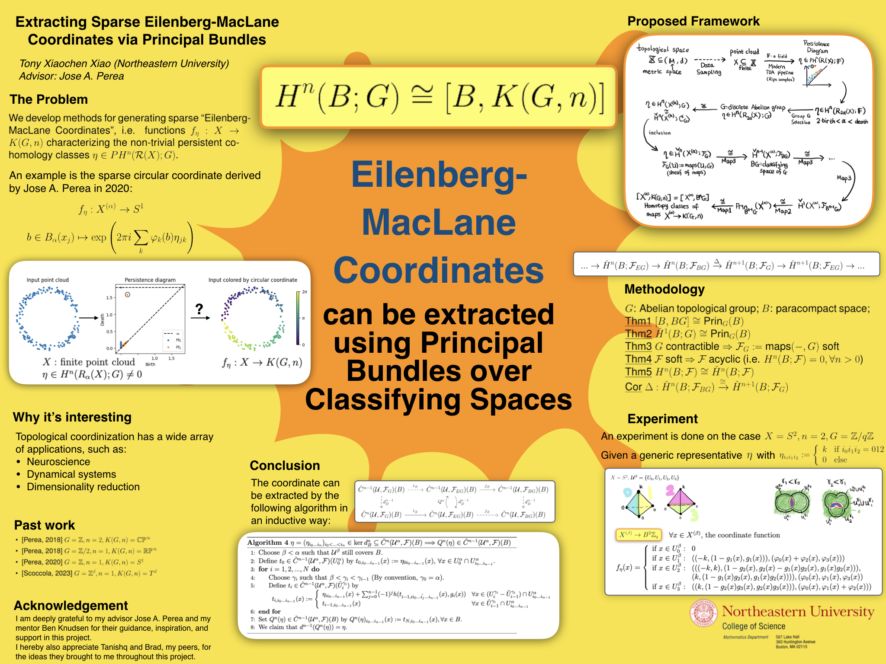

**Abstract.** In this paper, we address the construction of Eilenberg-MacLane coordinates — functions from datasets to Eilenberg-MacLane spaces $$K(G,n)$$ — that encode nontrivial persistent cohomology classes in arbitrary dimensions $$n$$ and coefficient group $$G$$. The construction leverages the connecting homomorphism in the long exact sequence in Čech cohomology, from the short exact sequence of sheaves of continuous maps with values in $$G$$, $$EG$$ and $$BG$$. Crucially, the derivation is constructive: we give an explicit, recursive formula for preimages under the connecting homomorphism, which yields a constructive version of a classical cohomology vanishing theorem and, in turn, an algorithm for general Eilenberg-MacLane coordinates. We validate our approach through experiments on synthetic datasets, and present novel examples of $$K(\mathbb{Z}/2, 2)$$-coordinates not addressed in prior work.

  

<!--

---
title: "Paper Title Number 1"
collection: publications
category: manuscripts
permalink: /publication/2009-10-01-paper-title-number-1
excerpt: 'This paper is about the number 1. The number 2 is left for future work.'
date: 2009-10-01
venue: 'Journal 1'
slidesurl: 'http://academicpages.github.io/files/slides1.pdf'
paperurl: 'http://academicpages.github.io/files/paper1.pdf'
bibtexurl: 'http://academicpages.github.io/files/bibtex1.bib'
citation: 'Your Name, You. (2009). &quot;Paper Title Number 1.&quot; <i>Journal 1</i>. 1(1).'
---
The contents above will be part of a list of publications, if the user clicks the link for the publication than the contents of section will be rendered as a full page, allowing you to provide more information about the paper for the reader. When publications are displayed as a single page, the contents of the above "citation" field will automatically be included below this section in a smaller font.

---
title: "Paper Title Number 5, with math $$E=mc^2$$"
collection: publications
category: conferences
permalink: /publication/2024-02-17-paper-title-number-4
excerpt: 'This paper is about a famous math equation, $$E=mc^2$$'
date: 2024-02-17
venue: 'GitHub Journal of Bugs'
paperurl: 'http://academicpages.github.io/files/paper3.pdf'
citation: 'Your Name, You. (2024). &quot;Paper Title Number 3.&quot; <i>GitHub Journal of Bugs</i>. 1(3).'
---
Using [MathJax](https://www.mathjax.org/) in the description is supported - $$E=mc^2$$ - however, the use must be mindful that the default delimiters are `$$...$$` and `\\[...\\]` which differs from the `$...$` that is typically expected.

-->
